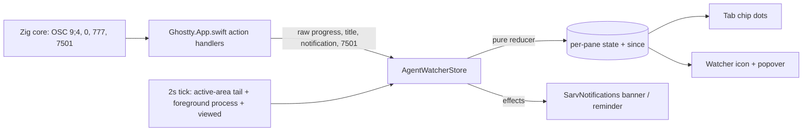

# Agent Watcher - Plan

## Goal Capsule

- **Objective:** A user running AI coding agents in several SarvTerminal tabs can see at a glance which agent is working, which is idle, and which is waiting for them, and is reminded until a waiting agent is answered, so a missed notification no longer leaves an agent stalled unnoticed.
- **Means:** a pure per-pane agent state reducer fed by terminal signals the app already receives plus a new OSC 7501 report (KTD1, KTD2, KTD9), surfaced as a watcher icon and popover in the tab strip plus state-coloured tab dots (KTD6).
- **Authority:** this plan's Product Contract, then the KTDs, then the global and project rules in `~/.claude/CLAUDE.md`, `AGENTS.md`, and the project memories.
- **Stop conditions:** stop and ask if Claude Code's live signals contradict the capture in Sources (for example no `OSC 9;4;3` while working), or if adding the OSC 7501 action breaks the GTK build in a way that needs more than a no-op case.
- **Execution profile:** one change set, left uncommitted on the working tree. No commits, pushes, issues, or PRs.
- **Who finishes:** the agent implements, unit-tests, builds with `scripts/dev.sh --fast`, and runs a pty smoke against the built app's logic. The user does the final in-app check with Claude Code and asks for the commit; the LINUX-ROADMAP.md entry is written at that commit.

---

## Product Contract

### Summary

SarvTerminal gains an Agent Watcher. Every pane running an AI agent gets a persistent state: working, idle, needs you, or done. A watcher icon after the Vaults/SFTP island summarises those states, and its popover lists the agent tabs in tab order with a jump button for each. Tab chips show working, needs you, and done as a coloured dot that stays until the state changes; idle shows the normal terminal icon with no dot. An agent that keeps waiting re-notifies every 5 minutes.

### Problem Frame

Today agent attention is edge-triggered. A bell or desktop notification sets an orange dot that clears the moment the tab is viewed, and a banner that is missed is gone. A bell cannot tell "finished" from "needs your permission". With several agents running, the user loses track of which one is blocked and agents sit idle waiting for an answer nobody saw.

### Requirements

**State model**

- R1. Each pane has one agent state: no agent, idle, working, needs you, or done.
- R2. A state persists until a new signal changes it; viewing a tab does not clear working or needs you.
- R3. Done becomes idle once its tab has been on screen while the app is active.
- R4. A pane with no detected agent keeps today's clear-on-view orange attention dot.
- R5. A tab's state is the most urgent of its panes, ordered needs you, done, working, idle.

**Detection**

- R6. Working is detected from `OSC 9;4` progress and the agent title spinner, independent of the `progress-style` setting and the 15-second progress-bar auto-clear.
- R7. Needs you is detected from a notification body that asks for permission or input, from an OSC 7501 `blocked` report, or from a known agent prompt visible on screen.
- R8. Screen reading is only a fallback, limited to known Claude Code and Codex prompt phrases, and only runs for panes already known to host an agent.
- R9. OSC 7501 reports set state directly, and the terminal answers the OSC 7501 `?` query so agents that support the protocol can detect it.
- R10. Agents running over SSH or inside tmux are detected from escape sequences and title glyphs; once such a pane is a known agent pane, the screen read applies to it too.
- R11. A pane returns to no agent when the agent exits.

**Watcher UI**

- R12. A watcher icon sits right after the Vaults/SFTP island, outside it. It shows an orange count of needs-you tabs, pulses while any tab needs you, is tinted while any agent works, and is plain otherwise. It has a tooltip.
- R13. Clicking the icon opens a popover listing this window's agent tabs in tab position order. Each row shows the ⌘N position, tab name, a coloured state chip, and time in state. Needs-you rows are highlighted orange.
- R14. Clicking a row, or its "go to tab" arrow button, selects the tab and closes the popover. The arrow shows on hover and always on needs-you rows, with tooltip "Go to tab N".
- R15. Pressing a digit 1-9 while the popover is open jumps to that tab position and closes the popover.
- R16. A tab with several agent panes shows each pane as an indented sub-row; clicking a sub-row focuses that pane.
- R17. Tabs without agents are not listed; a footer reads "N other tabs have no agent" when N > 0.
- R18. Tab chips show a state-coloured dot for agent tabs in working, needs you, or done, persisting per R2. Idle agent tabs show no dot.

**Notifications**

- R19. Entering needs you sends one banner, unless that tab is on screen in the active app.
- R20. While needs you persists and the tab is not on screen, a reminder banner fires every 5 minutes. A reminder replaces the previous banner and does not add a new inbox row. It respects the "Tab prompts" notification toggle.
- R21. Clicking an agent banner opens the window that holds the tab, even when it is not the frontmost window.

### Acceptance Examples

- AE1. Claude is working in tab 2, the user views tab 2 and then leaves: tab 2 still shows working.
- AE2. Claude shows "Do you want to create hello.txt?" in tab 3: within about 3 seconds tab 3 becomes needs you, the icon shows "1" and pulses, and one banner fires. When the `OSC 777` "Claude needs your permission" arrives about 6 seconds later, no second banner fires.
- AE3. The user leaves that prompt unanswered with tab 3 off screen: a reminder fires at 5 and 10 minutes, and the inbox holds one row for it.
- AE4. The user answers "No" on the prompt and Claude stops without working: the pane becomes idle once the prompt has left the screen.
- AE5. Claude finishes a turn in tab 4 while tab 1 is selected: tab 4 shows done. Selecting tab 4 turns it idle.
- AE6. The user quits Claude with Ctrl-C twice: the pane returns to no agent and the tab leaves the popover.
- AE7. A plain shell tab rings the bell: it gets today's orange dot, which clears on view, and never appears in the popover.

### Scope Boundaries

- Linux/GTK gets no watcher UI. Only the core OSC 7501 action compiles there as unimplemented, and a LINUX-ROADMAP.md entry is written at commit time.
- No settings UI for the reminder interval or the feature; 5 minutes is fixed.
- No cross-window popover. Each window lists its own tabs; R21 fixes banner routing only.
- No scanning of agent output beyond the listed prompt phrases. No parsing of transcripts or agent logs.

### Sources

- Live pty capture of Claude Code 2.1.326 with `TERM_PROGRAM=ghostty`, recorded this session:
  - Working emits `OSC 9;4;3` immediately and about every 5 seconds, with a `◐`/`◑` title spinner.
  - A finished turn and a freshly shown permission prompt look identical (`9;4;0` plus a `✳` title). About 6 seconds later `OSC 777;notify;Claude Code;Claude needs your permission` arrives.
  - After 60 seconds idle, Claude sends "Claude is waiting for your input".
  - Exit sends `9;4;0` and an empty `OSC 0` title.
  - Claude sends the `OSC 7501;?` query but no reports, even when answered.
  - The "Do you want to" prompt is drawn with cursor moves, so only the rendered screen contains the phrase.
- OSC 7501 Program Status Protocol spec: https://www.superlogical.com/rex/docs/build/program-status
- Inspiration: https://herdr.dev

---

## Planning Contract

### Key Technical Decisions

- KTD1. State lives in one app-wide `AgentWatcherStore` keyed by surface id, with a pure reducer `(state, event, now) -> (state, effects)`. Views and the per-window `VaultsTabsModel` read it; side effects (banners, timers, screen reads) run at the edges. This follows the global rule for pure, unit-testable logic, and an app-wide store means every window's model can read the same truth even though each model receives every notification today.
- KTD2. Raw signals are tapped where they enter Swift, before any UI gating. `Ghostty.App.progressReport` posts the raw OSC 9;4 state before the `progress-style` guard. The title handler posts the raw title. The existing `.sarvSurfaceDesktopNotification` and `.ghosttyBellDidRing` posts are reused. `surfaceView.progressReport` is not read, because its 15-second auto-clear and config gate would make "nil" ambiguous.
- KTD3. A `9;4;0` after working moves to done, not idle. A 2-second watcher tick reads the bottom of the active screen area (a `GHOSTTY_POINT_ACTIVE` read, so scrollback position does not matter) only for agent panes in done or needs-you. A known prompt phrase there promotes the pane to needs you. The pane records where needs you came from (screen, notification, or 7501). Only a screen-sourced needs you whose phrase was seen and then vanishes, without new progress, demotes to idle; notification- and 7501-sourced needs you stays until a new signal changes it. This catches permission prompts about 6 seconds before Claude's own notification, and answers AE4. (session-settled: user-approved — chosen over relying on OSC 777 alone: it arrives late and never arrives for an answered "No".)
- KTD4. The existing private `messageNeedsAttention` keyword lists move into a shared pure helper (no-duplication rule). The banner path keeps today's two-way verdict, where unknown text means notify. The reducer uses a stricter three-way verdict built on the same lists: needs you, idle, or no change. Unknown text, "review", "select", or a bare "?" must not pin a lasting needs-you state. "Waiting for your input" is idle.
- KTD5. For agent panes, the watcher owns banners only for notifications the three-way classifier marks needs-you; every other agent-pane notification, and every non-agent-pane notification, keeps today's `handleSurfaceNotification` path. So AE2 gets one banner. Reminders go through a `SarvNotifications` variant that replaces the banner by tab id, skips the inbox mirror, and passes the same `isEnabled(.tabs)` check.
- KTD6. The watcher icon reuses the `VaultsBellView` shape (SF Symbol `binoculars`, Capsule badge, `.popover(arrowEdge: .bottom)`), placed between `navSegment` and `divider` in `VaultsTabStrip`. Popover rows use `.listRowHover()` and `.help(...)`; the strip icon uses `.hoverTip`. (session-settled: user-directed — chosen over a status column in the Vaults sidebar: the user asked for an icon beside SFTP.)
- KTD7. Digit keys in the popover use an `NSEvent` local key monitor installed while the popover is open, because the macOS 13 deployment target rules out `.onKeyPress`. Only plain digits without modifiers are consumed, so Ghostty's ⌘N bindings are untouched.
- KTD8. Agent presence and exit:
  - A pane becomes an agent pane on any agent signal: `OSC 9;4;3`, a title starting with a spinner glyph or `✳`, an OSC 7501 report, or a foreground process named `claude` or `codex`.
  - It returns to no agent when one of these happens:
    - after a cleared `9;4;0`, a title arrives with no spinner or `✳` prefix (Claude's exit sends an empty title, which the core replaces with the pwd in `stream_handler.zig` before Swift sees it);
    - the foreground process becomes a shell (`zsh`, `bash`, `fish`, `sh`) while the title carries no agent glyph;
    - the tab closes.
  - SSH and tmux panes, whose foreground process stays `ssh` or `tmux`, rely on the title rule.
- KTD9. OSC 7501 is plumbed through the Zig core like `progress_report`:
  - `stream_handler.zig` replies to `?` with the BEL- or ST-terminated `query_reply` matching the query's terminator.
  - It forwards reports as a new `program_status` apprt action carrying only the state and blocked-kind enums, so no strings cross the boundary. Only records without a child `id` are forwarded; `clear` maps to idle.
  - GTK lists the action under its unimplemented cases.
  (session-settled: user-approved — chosen over skipping 7501: the spec is published and costs one action.)
- KTD10. Banner click routing finds the controller whose model contains the tab via `HostManagerController.all`, instead of `VaultsTabsModel.shared`, so R21 holds for multi-window use.
- KTD11. Stale state is expired, not trusted forever. Working with no `9;4;3` refresh and no spinner title change for 20 seconds becomes done, which covers a crash or `kill -9`. The tick runs while any terminal surface exists, samples the foreground process for every pane, and sends `viewed` for panes of on-screen tabs while the app is active (so a done that lands on the visible tab becomes idle). On each tick, entries whose surface id is no longer in any tab's split tree are dropped, which covers SSH reconnect replacing a pane's view. State is keyed by pane, so a detached pane keeps its state under its new tab.

### High-Level Technical Design

State machine per pane (directional, not code):

```mermaid
stateDiagram-v2
    [*] --> NoAgent
    NoAgent --> Working: 9;4;3 / spinner title / 7501 working
    NoAgent --> Idle: ✳ title / agent process / 7501 idle
    NoAgent --> NeedsYou: 7501 blocked
    NoAgent --> Done: 7501 done / error
    Idle --> Working: 9;4;3 / spinner / 7501 working
    Done --> Working: 9;4;3 / spinner
    NeedsYou --> Working: 9;4;3 / spinner
    Working --> Done: 9;4;0 / 7501 done
    Working --> NeedsYou: permission notification / 7501 blocked
    Done --> NeedsYou: prompt on screen / permission notification
    Idle --> NeedsYou: permission notification / 7501 blocked
    NeedsYou --> Idle: screen-sourced prompt gone, no progress
    Done --> Idle: tab viewed while app active
    Idle --> NoAgent: exit signature / shell foreground
    Done --> NoAgent: exit signature / shell foreground
    NeedsYou --> NoAgent: exit signature / shell foreground
    Working --> NoAgent: exit signature
```

Signal flow:

### Risks

- Claude enables focus reporting (`?1004`) and may skip its `OSC 777` while the pane is focused. In that case the screen read may be the only early needs-you signal; it stays a fallback in scope (R8: known phrases, agent panes only).
- Over SSH, `TERM_PROGRAM` is not forwarded by default and remote Claude may skip `9;4` and `777`. Inside tmux, those sequences are dropped without passthrough. Remote and tmux agents then rely on the title glyph and the screen read, and presence detection is weaker.
- Reminders are computed from `lastNotifiedAt`, so waking from sleep fires one reminder, not a burst. There is no reminder cap, as the user asked for one every 5 minutes.

### Assumptions

- Codex emits `OSC 9;4` and `OSC 9`/`777` notifications through the same Ghostty paths as Claude. It could not be captured this session, so Codex relies on generic signals only; its prompt phrases are deferred until a capture exists.
- Reading the active-area tail every 2 seconds for a handful of agent panes is cheap (same `ghostty_surface_read_text` path as `liveVisibleText`); the SSH connection popup already polls it every 0.2 seconds.

---

## Implementation Units

### U1. Pure agent state reducer and shared message classifier

- **Goal:** the state model and every transition, with no AppKit dependency.
- **Requirements:** R1-R3, R5, R7, R8, R11, R19, R20; KTD1, KTD3, KTD4, KTD8, KTD11.
- **Files:** `macos/Sources/Features/AgentWatcher/AgentState.swift` (new), `macos/Sources/Features/AgentWatcher/AgentStateReducer.swift` (new), `macos/Sources/Features/AgentWatcher/AgentMessageClassifier.swift` (new), `macos/Sources/Features/HostManager/VaultsTabsModel.swift` (call the extracted classifier), `macos/Tests/Features/AgentWatcher/AgentStateReducerTests.swift` (new), `macos/Tests/Features/AgentWatcher/AgentMessageClassifierTests.swift` (new).
- **Approach:**
  - Events: progress(raw state), title(text), notification(body), programStatus(state, kind), screenSample(tail text), foreground(process name), viewed, tick. Bell is not an event; it keeps today's path.
  - Effects: notify(needsYou), remind, none.
  - Pane state carries the state, `since`, `lastNotifiedAt`, whether the last progress was cleared, the needs-you source (screen, notification, 7501), and whether the screen phrase has been seen.
  - The prompt phrase list is a constant of Claude Code phrases: "Do you want to", "Would you like to", "Allow". Codex phrases are added once a Codex capture exists. Match against the last 15 non-blank lines of the active area only.
  - The reducer also exposes a pure `tabState(panes:)` aggregation per R5.
  - `messageNeedsAttention` moves verbatim into the classifier, gains tests, and `VaultsTabsModel` calls it.
- **Execution note:** test-first; write the AE-derived scenarios before the reducer.
- **Test scenarios:**
  - `9;4;3` from no agent gives working; `9;4;0` then gives done.
  - Done plus screen tail containing "Do you want to proceed?" gives needs you and one notify effect.
  - A later permission notification while needs you gives no second notify effect (AE2).
  - Screen-sourced needs you plus a tail without the prompt phrase and no new progress gives idle (AE4).
  - 7501-sourced and notification-sourced needs you plus a tail without a prompt phrase stay needs you.
  - Needs you at t=0, tick at t=299s gives no effect; at t=300s gives remind; at t=600s remind again (AE3).
  - Viewed while working stays working; viewed while done gives idle (AE1, AE5). A `9;4;0` on the visible tab followed by the tick's `viewed` gives idle.
  - Working with no progress or title change for 20 s gives done; a refresh at 19 s keeps working.
  - Notification text "Please review the diff?" from done does not give needs you (three-way classifier).
  - `9;4;0` followed by a plain title (the pwd the core substitutes for an empty title) gives no agent (AE6); `9;4;0` followed by `✳ Claude Code` stays done.
  - A spinner title `◐ Fixing tests` from no agent gives working.
  - "Claude is waiting for your input" from done stays done, and from idle stays idle.
  - A prompt phrase in the screen tail of a no-agent pane is ignored (R8).
  - 7501 blocked/permission gives needs you; 7501 error gives done.
  - Tab aggregation of [idle, needs you, working] gives needs you.
  - Remind effects are suppressed when the "Tab prompts" toggle is off (pure gate shared with banners).
  - Classifier: existing actionable and idle keyword examples keep their current verdicts.
- **Verification:** reducer and classifier tests pass.

### U2. Raw signal taps and the AgentWatcherStore

- **Goal:** feed real per-surface signals into the reducer and publish state for the UI.
- **Requirements:** R2, R6, R10, R11; KTD1, KTD2, KTD8, KTD11.
- **Dependencies:** U1, U3.
- **Files:** `macos/Sources/Ghostty/Ghostty.App.swift` (post raw progress before the `progressStyle` guard; post raw title in `setTitle`), `macos/Sources/Features/AgentWatcher/AgentWatcherStore.swift` (new), `macos/Sources/Features/HostManager/VaultsTabsModel.swift` (notification name constants beside `sarvSurfaceDesktopNotification`; forward viewed and tab-close events).
- **Approach:**
  - The store is a `@MainActor` `ObservableObject` singleton holding `[UUID: AgentPaneState]`. It observes the new and existing notifications with `object` set to the `SurfaceView`.
  - It runs one tolerant 2-second `Timer` on `RunLoop.main` in `.common` mode, following `SSHConnectionController`, while any terminal surface exists. The tick samples `foregroundProcessName` for every pane and reads the active-area tail only for agent panes in done or needs you.
  - `VaultsTabsModel.selection` didSet and app activation send `viewed` for the shown tab's panes. `recordAndRelease` drops closed panes, and each tick prunes surface ids missing from every window's split trees (KTD11).
- **Test scenarios:** covered by U1; the store is glue. Add one test that posting a raw progress notification for a surface updates the store, using an injected clock.
- **Verification:** a debug log line per transition shows working, done, and needs you in sequence during a Claude permission run.

### U3. OSC 7501 core plumbing

- **Goal:** answer the 7501 query and deliver reports to Swift.
- **Requirements:** R9; KTD9.
- **Files:**
  - `src/termio/stream_handler.zig`
  - `src/apprt/surface.zig`
  - `src/Surface.zig`
  - `src/apprt/action.zig`
  - `include/ghostty.h`
  - `src/apprt/gtk/class/application.zig` (unimplemented case)
  - `macos/Sources/Ghostty/Ghostty.Action.swift`
  - `macos/Sources/Ghostty/Ghostty.App.swift`
  - `macos/Sources/Features/HostManager/VaultsTabsModel.swift` (the `.sarvSurfaceProgramStatus` name constant)
- **Approach:**
  - Mirror `progress_report` end to end.
  - The query reply reuses the parser's `query_reply` constant and matches the query's terminator.
  - The action carries the state and kind as C enums; each C enum ends with a `_MAX_VALUE` sentinel as AGENTS.md requires for `include/ghostty/vt/` style enums.
  - The Swift handler posts `.sarvSurfaceProgramStatus`.
- **Test scenarios:**
  - A Zig test in the stream handler, or the nearest testable layer, shows a `?` query writes `?:states=idle,working,done,blocked,error:kinds=permission,question,auth` with the matching terminator.
  - A report with `state=blocked:kind=permission` produces the action with those enums.
  - A record carrying a child `id` is ignored; `clear` produces idle.
- **Verification:** `zig build test -Dtest-filter=program_status` passes; `zig build -Demit-macos-app=false` succeeds.

### U4. Notification ownership, reminders, and routing

- **Goal:** one banner per needs-you episode, reminders every 5 minutes, clicks that land in the right window.
- **Requirements:** R4, R19, R20, R21; KTD5, KTD10.
- **Dependencies:** U2.
- **Files:** `macos/Sources/Features/Notifications/SarvNotifications.swift`, `macos/Sources/Features/HostManager/VaultsTabsModel.swift`, `macos/Sources/Features/AgentWatcher/AgentWatcherStore.swift`.
- **Approach:**
  - The store executes notify and remind effects through `SarvNotifications`. It skips them when the tab is on screen in the active app, using `isTabOnScreen` from the owning model.
  - Add a reminder path that reuses the tab dedupe identifier and skips the inbox mirror.
  - `handleSurfaceNotification` skips its banner when the store reports the surface as an agent pane, and keeps it for plain shells.
  - `navigate(.tab)` looks up the controller in `HostManagerController.all` whose model contains the tab, shows that window, and selects the tab.
- **Test scenarios:**
  - A pure helper decides whether to banner from (isAgentPane, verdict, isOnScreen, tabsEnabled, effect). Agent pane plus on screen gives no banner; plain shell plus off screen gives today's banner; an agent-pane notification the classifier does not mark needs-you keeps today's path; tabs toggle off gives no banner or reminder.
  - The pure lookup of the window that owns a tab returns the second window's controller when the tab lives there.
- **Verification:** U1 reminder tests plus these helpers pass.

### U5. Watcher icon and popover

- **Goal:** the visible watcher.
- **Requirements:** R12-R17; KTD6, KTD7.
- **Dependencies:** U2.
- **Files:** `macos/Sources/Features/AgentWatcher/AgentWatcherButton.swift` (new), `macos/Sources/Features/AgentWatcher/AgentWatcherPopover.swift` (new), `macos/Sources/Features/HostManager/VaultsTabStrip.swift` (insert between `navSegment` and `divider`), `macos/Sources/Features/HostManager/VaultsTabsModel.swift` (a `focusPane(tabID:surfaceID:)` that handles focus mode and zoom).
- **Approach:**
  - The button takes the window's own `VaultsTabsModel`, never `.shared`.
  - Badge, pulse (a repeating opacity animation only while the needs-you count is above 0), and tint are derived by a pure `watcherSummary(tabs:)`. Needs you wins over working: badge and pulse, no working tint. With Reduce Motion on, the pulse becomes a static orange tint.
  - With no agent tabs the popover shows "No agents running", plus the footer when N > 0.
  - Rows are built by a pure `watcherRows(tabs:states:)` that returns position, name, state, since, and pane sub-rows. Pane labels use the existing `paneDisplayTitle`.
  - Time in state refreshes with `TimelineView(.periodic(from:by: 30))`.
  - The digit monitor is installed in `onAppear` and removed in `onDisappear` of the popover content.
  - Row click, arrow click, and digit all call the same `jump(to:)` and set `isPresented = false` (dropdown-closes-on-selection rule).
- **Test scenarios:**
  - `watcherRows` orders by tab position, excludes no-agent tabs, and counts them for the footer.
  - A tab with two agent panes yields two sub-rows.
  - `watcherSummary` gives count 2 and pulsing for two needs-you tabs; tinted with no badge when only working; plain when all idle; one needs you plus one working gives badge 1, pulse, no tint; Reduce Motion gives static tint instead of pulse.
  - Four tabs with three listed: digit 4 selects position 4. Digit 0 and digits above the total tab count are ignored.
  - Zero agent tabs gives the empty "No agents running" state, with the footer when other tabs exist.
- **Verification:** tests pass; the app builds; the icon renders after the SFTP pill in the dev build.

### U6. State-coloured persistent tab dots

- **Goal:** chip dots reflect agent state.
- **Requirements:** R4, R18.
- **Dependencies:** U2.
- **Files:** `macos/Sources/Features/HostManager/VaultsTabStrip.swift` (`TerminalTabItem` leading slot, `TabChip` parameter).
- **Approach:**
  - Replace the `needsAttention: Bool` parameter with an optional dot from a pure `chipDot(agentState:hasAttention:)` returning colour, tooltip, and accessibility label together.
  - Colours: orange for needs you, blue for working, green for done, none for idle.
  - Non-agent tabs keep the orange dot from `attentionTabs`.
  - The hover-reveals-close behaviour is unchanged.
- **Test scenarios:**
  - `chipDot` returns orange for needs you even when the tab is selected.
  - It returns nil for idle.
  - It returns orange for a non-agent tab with attention, and nil for a non-agent tab without it.
  - Each dot's tooltip and accessibility label name the state ("Agent needs you", "Agent working", "Agent done").
- **Verification:** tests pass.

---

## Verification Contract

- Unit tests: `macos/build.nu --action test` (Swift Testing; the new files are picked up by the synchronized groups).
- Zig: `zig build test -Dtest-filter=program_status`, then `zig build -Demit-macos-app=false`.
- Formatting: `swiftlint lint --strict --fix` and `zig fmt` on touched Zig files.
- Dev build: `scripts/dev.sh --fast`, relaunching only the dev instance.
- Smoke, by the agent: rerun `capture_claude.py` (session scratchpad) against Claude, extract its signal sequence (9;4 states, titles with empty titles replaced by the pwd as the core does, OSC 777 bodies, and a screen-tail sample at the prompt) into a small test fixture, and replay it through the reducer. This confirms working, done, needs you, and no agent fire in order without the GUI.
- Final check, by the user: run Claude in two tabs, trigger a permission prompt in the background tab, and confirm AE1-AE7 in the app.
- Graph: `graphify update` after the code changes.

---

## Definition of Done

- U1-U6 are implemented and every listed test passes.
- The Zig core and macOS dev build succeed. The GTK build compiles the new action as unimplemented, or the GTK compile was not runnable on macOS and that is stated.
- The replayed Claude capture drives the expected state sequence.
- No new dialogs, no overridden Ghostty keybinds, every new icon has a tooltip, and every clickable row has hover.
- Experimental or abandoned code is removed from the diff.
- Changes are left uncommitted; the LINUX-ROADMAP.md entry is noted as owed at commit time.
